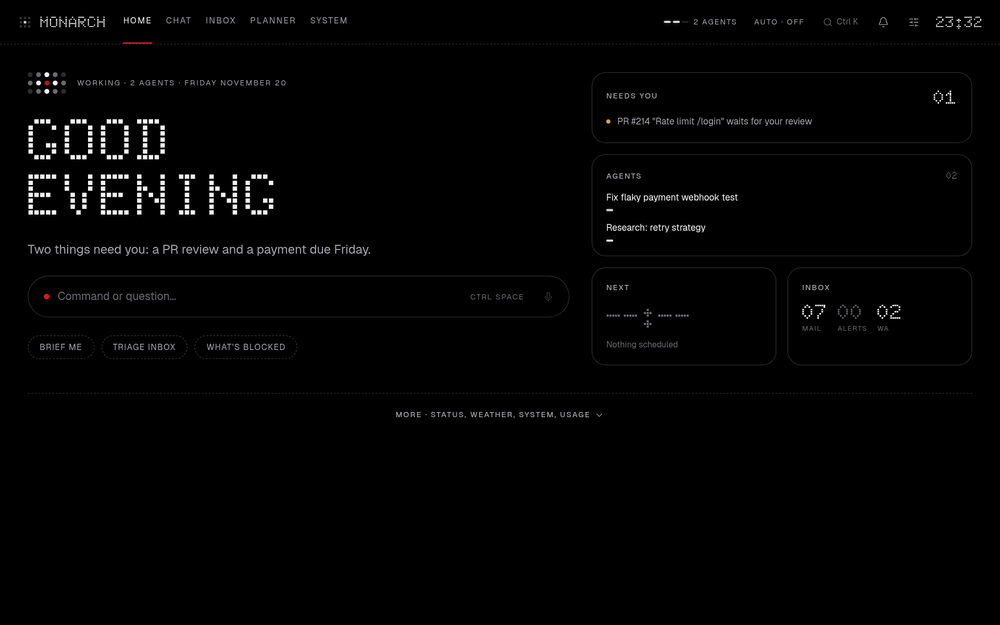
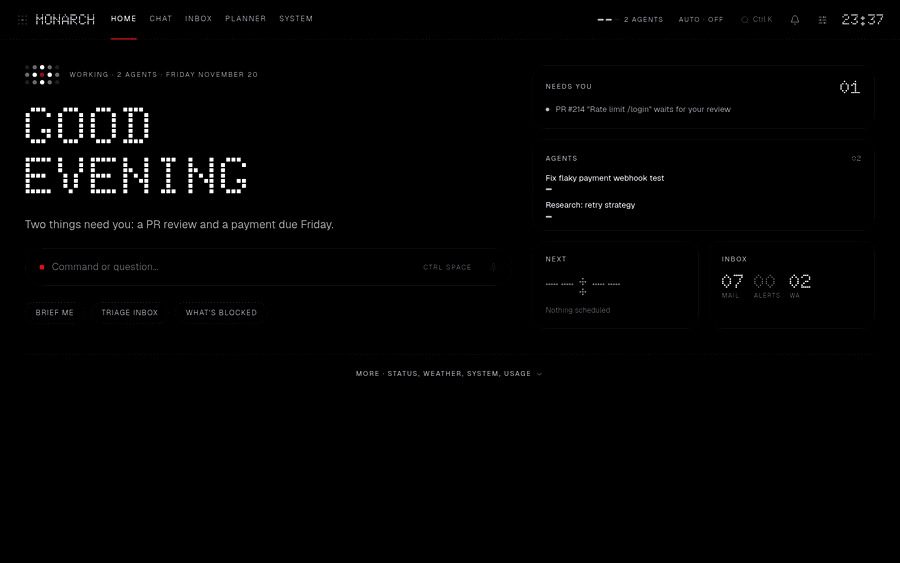

<div align="center">


# Monarch

**A personal AI operating system for your work and your life.**

One calm workspace where AI agents chat, write code, run your inbox, calendar, Slack, WhatsApp and money,
and only interrupt you when it matters.

[](https://github.com/monarch-forge/monarch-ai/releases/latest)


[**Download**](#install) · [Features](#features) · [Setup](docs/SETUP.md) · [Development](docs/DEVELOPMENT.md)

<br />



</div>

## Demo

A 45-second tour of Home, Chat, Workshop, Office, Inbox, Agenda, Ledger, System, Evolve, the Ctrl+K palette and Settings, using demo data.



[Watch the full-quality video (MP4)](docs/pictures/demo.mp4)

## Why Monarch

- **One place for everything.** Work and personal life in one app: mail, chat apps, calendar, tasks, code and money, with one agent that sees all of it.
- **Hands-off when you want it.** Auto mode lets agents work through requests on their own. Sending, posting and deleting still wait for your approval, and you get a notification when you're needed.
- **Local first.** Monarch runs on your machine. Your data lives in `~/.monarch-ai`, secrets never reach the UI, and optional encrypted sync goes to a private repo you own.
- **Any model.** Use your Claude subscription, any API provider, or a local model. Small models such as Gemini Flash get a tuned mode so they stay useful.
- **It grows with you.** Monarch learns facts about you, drafts reusable skills from tasks that worked, and can write and test its own extensions.

## Features

### Agents

| | |
|---|---|
| **Chat** | Your chief of staff. Streams replies, shows tool calls as cards, keeps a pinned board of ongoing threads, and hands heavy work to worker agents. |
| **Workshop** | Coding agents that read, edit, run and test code in your repos, open pull requests with `gh`, and fix their own failing checks (up to 2 rounds) before reporting done. |
| **Office** | A pixel-art office where every agent has a desk. See at a glance who is working, who just finished, who is on a break and who needs you. |
| **Projects** | Add a folder of repos. Monarch learns how to build, test and run each one from its own files, so no `AGENTS.md` is needed. |
| **Auto mode** | Agents act on their own. The first message to a new person, the first edit in a new repo, and any change over 25 items ask once. |

### Your day

| | |
|---|---|
| **Home** | Greeting, what needs you, running agents, the next event and unread counts, plus a command bar. |
| **Inbox** | Several Gmail accounts, Slack (as yourself) and WhatsApp in one place. Every send needs approval. |
| **Planner** | Google Calendar, tasks, reminders and scheduled automations, including a morning brief shown on Home. |
| **Ledger** | Spending and income by month, budgets, several currencies, bank, cash, e-wallet and credit card accounts, and due-date reminders. Agents can record entries from transaction emails. |
| **Memory** | An Obsidian-compatible markdown vault with links, tags, backlinks and a graph, plus an editable "What Monarch knows" page. |
| **Voice** | Speak your request and hear the reply, through OpenAI, Groq, ElevenLabs or any compatible service. |

### Everywhere

| | |
|---|---|
| **Android app** | A remote for the Monarch on your laptop, over Tailscale or your Wi-Fi. Pair once with a link. |
| **Sync** | Encrypts all your data with your passphrase and keeps it in a private repo. Restore on any device. |
| **MCP servers** | Add any Model Context Protocol server, local or remote, including ones that sign in with OAuth. |
| **Evolve** | Ask for a capability Monarch lacks and it writes, sandboxes and tests an extension or skill, with versioning and rollback. |
| **Command palette** | `Ctrl/⌘+K` reaches every page and action. |

<details>
<summary><b>More detail on every feature</b></summary>

- **Threads board.** Chat keeps a short, pinned list of ongoing threads, each with a status, a next step, an area tag (work, personal, a repo, a person) and links to workers, PRs or mail. It survives compaction and is shown in Chat's side panel. When a linked worker finishes, Chat is prompted to update the thread and report back.
- **Better coding on small models.** Workers get a compact repo map (files with their key functions and classes, refreshed by commit), a `repo_map` tool to find definitions, and a short plan (`plan_set` / `plan_step`). Open plan steps and a failing check both send the worker back before it can report done.
- **Works on small models.** Small-model mode (automatic for Flash/Lite/mini-class models, or set in Config → Models) loads the common tools up front, uses a compact prompt, fixes common argument slips and catches cut-off replies. Models that write tool calls as text instead of making real calls still work: Monarch runs those calls for real and feeds the results back.
- **Default model per agent.** Config → AI → Models sets the default model for Chat, Workshop, Chat sub-agents and Workshop sub-agents. An explicitly requested model still wins.
- **Learned skills.** When the same kind of task succeeds twice, Monarch drafts a reusable skill for you to approve in System → Evolve.
- **Pull requests.** Workshop shows PRs waiting on you with their CI state, and "Review with agent" drafts a review that is only posted after you approve it.
- **Automations.** Ready-made templates cover a morning briefing, inbox triage (drafts only, never sends), importing bank-email transactions into the Ledger, and a Slack digest. Each one is a normal automation you can edit or delete.
- **WhatsApp.** Link your number with a QR code in Config → Accounts. It is an unofficial bridge, so there is some risk of a ban.
- **Slack.** Read channels, DMs and threads, catch up on unread messages, search, post and reply in threads, react, edit, delete and schedule messages, all as yourself with a user token.
- **Ledger credit cards.** Cards show the amount owed, available credit, statement cycle and amount due, and you get a notification 3 days before a payment is due. Duplicate entries are skipped using a source reference.
- **Lean prompts.** Only about 14 core tools load into each prompt; the rest, including every extension tool, are found on demand through tool search. That roughly halves the prompt.
- **Context meter and auto-compaction.** Every session shows how much of the model's context it uses. Long sessions compact automatically at 75% (adjustable), and `/compact` compacts on demand.
- **Phone access.** Off by default. Turn it on in Config → Phone access. Phones pair once and can be revoked.
- **9Router.** Live status and diagnostics for a local model proxy at `localhost:20128`.

</details>

## Install

Download the installer for your platform from the [latest release](https://github.com/monarch-forge/monarch-ai/releases/latest).

| Platform | File | How |
|---|---|---|
| **Arch Linux** | `monarch-ai-bin-0.18.1-1-x86_64.pkg.tar.zst` | See below |
| **Debian / Ubuntu** | `Monarch_0.18.1_amd64.deb` | `sudo apt install ./Monarch_0.18.1_amd64.deb` |
| **Fedora / openSUSE** | `Monarch-0.18.1-1.x86_64.rpm` | `sudo dnf install ./Monarch-0.18.1-1.x86_64.rpm` |
| **Any Linux** | `Monarch_0.18.1_amd64.AppImage` | `chmod +x` it, then run it |
| **macOS (Apple Silicon)** | `Monarch_0.18.1_aarch64.dmg` | Drag to Applications |
| **macOS (Intel)** | `Monarch_0.18.1_x64.dmg` | Drag to Applications |
| **Windows** | `Monarch_0.18.1_x64-setup.exe` or `.msi` | Run the installer |
| **Android** | `Monarch-0.18.1-android-arm64.apk` | Install, then pair with your laptop |

**Arch Linux.** Download the package, then install the local file:

```bash
curl -LO https://github.com/monarch-forge/monarch-ai/releases/download/v0.18.1/monarch-ai-bin-0.18.1-1-x86_64.pkg.tar.zst
sudo pacman -U ./monarch-ai-bin-0.18.1-1-x86_64.pkg.tar.zst
```

Don't pass the URL straight to `pacman -U`: the package isn't GPG-signed, and pacman rejects unsigned remote packages. Optional extras for notifications, opening links and faster code search: `sudo pacman -S --needed libnotify xdg-utils ripgrep`.

**Unsigned builds.** On macOS, right-click the app and choose **Open** the first time, or run `xattr -dr com.apple.quarantine /Applications/Monarch.app`. On Windows, if SmartScreen appears, choose **More info → Run anyway**.

### Requirements

- **Node.js 22.19 or newer** on your `PATH`. The app runs its core with your local `node`.
- **A model.** Either Claude Code logged in with `claude auth login` (uses your Claude subscription), or an API key for any provider, or a local model server.

## Getting started

1. **Open Monarch.** The welcome guide opens on first launch (and any time from `Ctrl+K`).
2. **Pick a model** in Settings → AI. See [model setup](docs/SETUP.md#models-and-accounts).
3. **Connect accounts** you want Monarch to use: Gmail, Calendar, Slack, WhatsApp. See [account setup](docs/SETUP.md#integrations).
4. **Ask for something** from the Home command bar, for example "Plan my week and triage my inbox".
5. **Turn on Auto** in the top bar when you're happy for agents to work without asking at every step.

## Privacy and safety

- The core listens on `127.0.0.1` only and accepts requests from the app alone.
- Every tool has a risk level. By default Monarch asks before sensitive and dangerous actions, and sending, posting or deleting always needs your approval.
- API keys and tokens stay in `~/.monarch-ai/secrets.json` (mode `600`) and are never sent to the UI.
- Extensions run sandboxed in their own process, with no network or shell access unless you grant it.

Full details: [security model](docs/DEVELOPMENT.md#security-model) and [data locations](docs/DEVELOPMENT.md#data-locations).

> **About Claude subscriptions.** Using *your own* Claude subscription through the Agent SDK on your own machine is personal use. If you ship Monarch to other people, have them use their own API keys or another provider. See [model setup](docs/SETUP.md#claude-through-your-claude-subscription-agent-sdk).

## Documentation

| | |
|---|---|
| [Setup](docs/SETUP.md) | Models, providers, Google, Slack, the memory vault, extensions and skills |
| [Integrations guide](docs/INTEGRATIONS.md) | Step-by-step account setup with troubleshooting |
| [Development](docs/DEVELOPMENT.md) | Architecture, building from source, desktop build, releasing, data, security, troubleshooting |
| [Architecture](docs/ARCHITECTURE.md) | Module ownership |
| [Design](docs/DESIGN.md) | The design system |

## Built with

Tauri v2 · Preact · Tailwind and daisyUI · Node (Hono) · Claude Agent SDK · pi-agent-core
